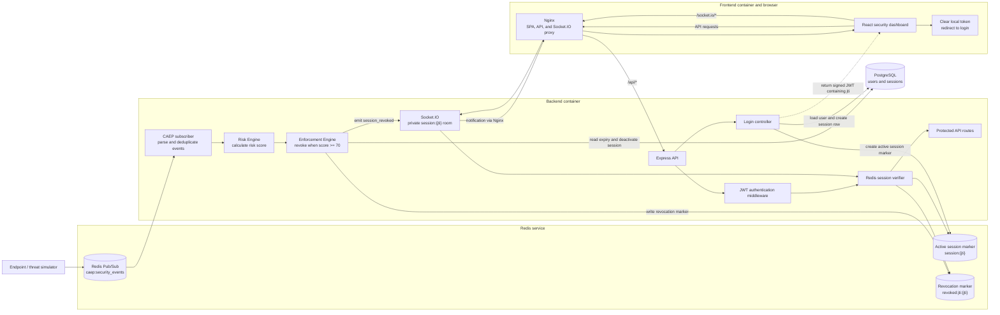

# ZeroPulse

### Zero Trust Continuous Access Evaluation Engine

ZeroPulse is a cybersecurity portfolio project that demonstrates continuous evaluation of authenticated sessions. Traditional authentication checks a user's credentials at login; ZeroPulse also processes security events after login and can revoke an active session when its risk score crosses the enforcement threshold.

## Key Features

- JWT-based login with a unique session `jti`.
- PostgreSQL user and session records, plus Redis active-session verification.
- CAEP-style security event processing over Redis Pub/Sub.
- Risk scoring and automatic revocation for high-risk events.
- Redis revocation markers and PostgreSQL session deactivation.
- Session-scoped Socket.IO notifications and a React security dashboard that forces logout.
- Docker Compose deployment with Nginx routing for the frontend, API, and Socket.IO.
- Backend hardening: Helmet, rate limits, environment validation, fail-closed session checks, and graceful shutdown.
- API load and end-to-end CAEP revocation benchmarks with sanitized reports.

> **Persistence boundary:** PostgreSQL stores users and sessions. `backend/init.sql` also creates `threat_events` and `audit_logs`, but the current backend does not write event or audit rows to those tables. The dashboard's recent threat events are kept in the backend's in-memory event buffer and delivered over Socket.IO; they are not durable audit history.

## Architecture



The standalone diagram is available at [docs/architecture.mmd](docs/architecture.mmd).

## Technology Stack

| Area | Technologies |
|---|---|
| Frontend | React, Vite, Nginx |
| Backend | Node.js, Express, Socket.IO |
| Security | JWT, bcrypt, CAEP-style events, Redis session revocation, Helmet, rate limiting |
| Database and infrastructure | PostgreSQL, Redis, Docker, Docker Compose |
| Benchmarking | Custom Node.js runners, `fetch`, `process.hrtime.bigint()`, Socket.IO client |

## How ZeroPulse Works

### Login and protected requests

1. A user submits credentials to the login endpoint; the backend checks the password against its bcrypt hash.
2. The backend creates a PostgreSQL session row and an active `session:{jti}` Redis marker, then returns a signed JWT containing the session `jti`.
3. The React app keeps the JWT for the logged-in session and connects to Socket.IO using that token.
4. Protected API requests pass through Nginx to Express. JWT middleware verifies the token and checks the Redis revocation marker and active-session marker before continuing.

### CAEP event and revocation flow

1. The endpoint agent or threat simulator creates a security event.
2. The event is published to Redis Pub/Sub on `caep:security_events`.
3. The CAEP subscriber parses the event and deduplicates event IDs.
4. The Risk Engine calculates a score. The current enforcement threshold is 70.
5. For a high-risk event, the Enforcement Engine writes `revoked:jti:{jti}` to Redis, marks the matching PostgreSQL session inactive, and emits a session-scoped Socket.IO notification.
6. The React app receives `session_revoked`, clears the local token, and redirects the affected browser to login.
7. Later protected requests with the revoked JWT are rejected with HTTP 401.

These are separate paths: login creates an active session; CAEP processing can later revoke that session. If Redis session verification is unavailable, protected requests fail closed with HTTP 503 rather than being allowed.

## Docker Setup

### Prerequisites

- Docker Desktop or Docker Engine.
- Docker Compose.

### Configure the environment

Copy the example file to the repository root and replace the placeholders with your own values:

```sh
cp .env.example .env
```

On PowerShell, use `Copy-Item .env.example .env`. Set a strong `DB_PASSWORD` and a unique `JWT_SECRET` of at least 32 characters. Do not commit `.env`; it is ignored by Git. Do not use the example placeholder values in a deployed environment.

### Start and inspect

```sh
docker compose up --build
```

Use `-d` to run in the background. The default Compose stack contains PostgreSQL, Redis, the backend, and the frontend. PostgreSQL and Redis are available to other containers by the service names `postgres` and `redis`; their ports are not published to the host.

```sh
docker compose ps
docker compose logs -f backend
docker compose logs -f redis
```

- Frontend: [http://localhost:5173](http://localhost:5173)
- Backend API: [http://localhost:5000](http://localhost:5000)

The Nginx frontend serves the React application and proxies `/api/` and `/socket.io/` to the backend.

### Local demo

No demo credentials or pre-seeded user are included. Sign in with an account provisioned in your local database. For a reproducible CAEP demo using a reserved disposable benchmark account and temporary sessions, follow [the benchmark setup instructions](backend/benchmark/README.md). The benchmark confirms Socket.IO delivery to an authenticated test client and the post-revocation HTTP 401; it is not a browser-automation run.

Stop the containers while preserving local data:

```sh
docker compose down
```

To deliberately reset the local database and Redis data, back up anything you need first, then run:

```sh
docker compose down -v
```

**Warning:** `-v` permanently removes the persistent PostgreSQL and Redis volumes. The next startup creates fresh volumes and initializes PostgreSQL from `backend/init.sql`.

## Security Features

- JWT signature and expiry verification; the session `jti` is checked against Redis.
- Redis revocation-marker and active-session checks for protected HTTP and Socket.IO connections.
- Fail-closed authentication: invalid, revoked, inactive, or mismatched sessions receive HTTP 401; Redis verification failures receive HTTP 503.
- Helmet security headers.
- Login rate limit: 10 attempts per 15 minutes per client IP; successful logins are not counted. Session revocation has a separate 10-request-per-15-minute IP limit. Rate-limited requests receive HTTP 429.
- Startup validation for required database, Redis, and JWT environment variables. Production requires a non-placeholder JWT secret of at least 32 characters.
- Graceful SIGINT/SIGTERM shutdown of HTTP, Socket.IO, the CAEP subscriber, Redis, and PostgreSQL.

ZeroPulse is a portfolio prototype. It is not represented as production-certified or enterprise-deployed.

## Benchmark Results

The results below are from the sanitized reports produced in a local Docker environment. API requests used concurrency 100. The environment recorded Node.js v22.23.5 on Linux x64; CPU and memory details were not captured.

### Protected API load

| Metric | Result |
|---|---:|
| Total requests | 1,000 |
| Successful requests | 1,000 (HTTP 200) |
| Throughput | 512.04 req/sec |
| Average latency | 184.68 ms |
| Median latency | 172.51 ms |
| p95 latency | 279.68 ms |
| p99 latency | 338.90 ms |

### CAEP revocation

| Metric | Result |
|---|---:|
| Total trials | 20 |
| Successful trials | 20 |
| Average event-to-Socket.IO emission (T6−T1) | 8.12 ms |
| p95 event-to-Socket.IO emission (T6−T1) | 9.16 ms |

The CAEP run used 20 sequential trials with a 10-second per-trial timeout. It confirmed the Redis revocation marker, PostgreSQL session deactivation, authenticated Socket.IO test-client receipt, and HTTP 401 on a subsequent request using the revoked JWT. Client receipt was measured separately from server emission. These local results depend on machine resources and configuration and are not production-scale performance claims.

- [Benchmark methodology and setup](backend/benchmark/README.md)
- [Sanitized API report](backend/benchmark/reports/api-load-2026-11-23T08-06-59-136Z-summary.json)
- [Sanitized CAEP report](backend/benchmark/reports/caep-revocation-2026-11-23T08-07-04-864Z-summary.json)

## Project Structure

```text
ZeroPulse/
├── backend/
│   ├── agents/          # Endpoint event producer
│   ├── benchmark/       # API and CAEP benchmarks, docs, sanitized reports
│   ├── config/          # PostgreSQL, Redis, environment validation
│   ├── controllers/
│   ├── middleware/      # Authentication and rate limiting
│   ├── routes/
│   ├── services/        # CAEP, risk, enforcement, session, Socket.IO
│   ├── simulator/       # Safe CAEP event simulator
│   ├── test/
│   ├── init.sql
│   └── server.js
├── docs/
│   └── architecture.mmd
├── frontend/
│   ├── public/
│   └── src/
├── docker-compose.yml
├── docker-compose.benchmark.yml
├── .env.example
└── README.md
```

## Future Improvements

- Add durable writers for the initialized audit and threat-event tables.
- Support distributed deployments and multi-node Redis configuration.
- Expand CAEP event coverage and make risk scoring more context-aware.
- Add production observability, including metrics and tracing.
- Add more automated security and browser-level end-to-end tests.
